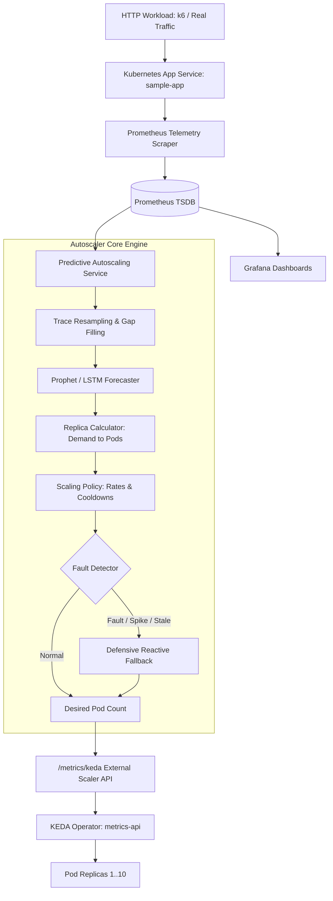

# Predictive Autoscaling with Load Forecasting

[](https://www.python.org/)
[](https://fastapi.tiangolo.com/)
[](https://facebook.github.io/prophet/)
[](https://pytorch.org/)
[](https://keda.sh/)
[]()

A complete, production-grade, two-semester capstone engineering project that implements **predictive autoscaling** for cloud-native Kubernetes workloads using machine learning (Facebook Prophet and PyTorch LSTM) and KEDA.

---

## 1. Motivation and Problem Statement

Standard Kubernetes Horizontal Pod Autoscaling (HPA) operates **reactively**: it observes resource utilization (e.g., CPU > 70%) and triggers pod creation *after* demand has arrived. Because application pods require 20 to 60 seconds to pull images, initialize, and pass readiness probes, reactive autoscaling suffers from **pod starvation, severe tail latency spikes (p99 > 350ms), and dropped requests**.

This project provides an end-to-end **predictive autoscaler** that forecasts future request load ahead of time and provisions pod capacity before traffic increases occur, while implementing safety margins, bounded step-scaling rates, stabilization cooldowns, and automatic reactive fallback upon abnormal conditions.

---

## 2. System Architecture



---

## 3. Repository Structure

```text
predictive-autoscaling/
├── app/
│   ├── main.py                     # FastAPI application entrypoint
│   ├── config.py                   # Pydantic Settings configuration
│   ├── schemas.py                  # Pydantic v2 schemas and data models
│   ├── forecasting/
│   │   ├── data_loader.py          # Data ingestion, SHA256 provenance & chronological split
│   │   ├── preprocessing.py        # Gap filling, IQR outlier capping, Prophet formatting
│   │   ├── prophet_model.py        # Facebook Prophet forecasting engine
│   │   ├── lstm_model.py           # PyTorch LSTM deep learning forecaster
│   │   └── evaluation.py           # MAE, RMSE, MAPE, and asymmetric error evaluation
│   ├── controller/
│   │   ├── replica_calculator.py   # Documented replica calculation formula & rate limits
│   │   ├── scaling_policy.py       # Cooldown timers, stabilization, decision audit logs
│   │   └── fallback.py             # Degraded mode & defensive reactive fallback
│   ├── metrics/
│   │   └── exporter.py             # Prometheus metrics exporter (12+ telemetry gauges)
│   └── services/
│       └── forecast_service.py     # Caching and model lifecycle service
├── data/
│   ├── raw/                        # Provenance raw traces
│   ├── processed/                  # Cleaned traces & serialized models
│   └── sample/                     # Synthetic benchmark traces (steady, ramp, spike, etc.)
├── workloads/
│   ├── workload_generator.py       # Python parameterized trace generator
│   ├── steady.js                   # k6 steady workload script
│   ├── ramp.js                     # k6 ramp-up workload script
│   ├── spike.js                    # k6 flash spike workload script
│   ├── periodic.js                 # k6 cyclical wave workload script
│   └── burst.js                    # k6 intermittent burst workload script
├── kubernetes/
│   ├── namespace.yaml              # Kubernetes namespace 'predictive-system'
│   ├── app-deployment.yaml         # Target sample application deployment
│   ├── app-service.yaml            # ClusterIP service for sample app
│   ├── forecast-deployment.yaml    # Controller deployment manifest
│   ├── controller-deployment.yaml  # Controller ClusterIP service
│   ├── reactive-hpa.yaml           # Reactive baseline HPA (target 70% CPU)
│   ├── keda-scaledobject.yaml      # KEDA ScaledObject with external metrics-api
│   ├── rbac.yaml                   # ServiceAccount, Role, and RoleBinding
│   ├── prometheus/                 # Prometheus config & deployment
│   └── grafana/                    # Grafana datasources, deployment & dashboard
├── experiments/
│   ├── run_experiment.py           # Repeatable simulation & experiment runner
│   ├── compare_results.py          # Statistical comparator & matplotlib visualizer
│   └── results/                    # Execution logs, raw traces, JSON summaries, and plots
├── tests/
│   ├── unit/                       # Unit tests (schemas, math, bounds, cooldowns)
│   ├── integration/                # Integration tests (FastAPI, Prometheus, KEDA API)
│   ├── fault_injection/            # Fault injection & degraded mode tests
│   └── acceptance/                 # Formal KPI acceptance criteria tests
├── scripts/
│   ├── setup.ps1                   # One-click Windows PowerShell setup
│   ├── setup.sh                    # One-click Linux / macOS setup
│   ├── start_local.ps1             # Local run script (PowerShell)
│   ├── start_local.sh              # Local run script (Bash)
│   └── train_model.py              # Model training and held-out evaluation runner
├── docs/                           # Comprehensive technical documentation
│   ├── architecture.md             # System & validation architecture
│   ├── requirements.md             # Functional & Non-functional requirements matrix
│   ├── api.md                      # Complete REST API reference
│   ├── installation.md             # Installation and operations runbook
│   ├── experiments.md              # Experimental design and empirical results
│   ├── troubleshooting.md          # Failure modes and mitigation steps
│   └── final_report.md             # Two-semester capstone final project report
├── Dockerfile                      # Production multi-stage Docker build
├── docker-compose.yml              # Local multi-container development environment
├── requirements.txt                # Pinned dependency manifest
└── README.md
```

---

## 4. Quick Start Guide

### Windows (PowerShell)
```powershell
# 1. Run automated environment setup
.\scripts\setup.ps1

# 2. Start the local server
.\scripts\start_local.ps1
```

### Linux / macOS (Bash)
```bash
# 1. Run automated environment setup
chmod +x scripts/*.sh
./scripts/setup.sh

# 2. Start the local server
./scripts/start_local.sh
```

The service will be live on `http://localhost:8000`:
- **Interactive OpenAPI Documentation**: [http://localhost:8000/docs](http://localhost:8000/docs)
- **Prometheus Telemetry Endpoint**: [http://localhost:8000/metrics](http://localhost:8000/metrics)
- **KEDA External Scaler Metric**: [http://localhost:8000/metrics/keda](http://localhost:8000/metrics/keda)

---

## 5. Running Experiments and Verifying Acceptance

To execute the identical 150-minute multi-phase trace across reactive HPA, predictive Prophet, and predictive LSTM models:

```powershell
# Execute benchmark experiments
.\.venv\Scripts\python.exe experiments/run_experiment.py --trace ./data/sample/workload_composite.csv

# Evaluate Acceptance Criteria & generate comparison plots
.\.venv\Scripts\python.exe experiments/compare_results.py
```

### Measured Real Execution Summary:

| Metric | Reactive HPA | Predictive (Prophet) | Impact |
| :--- | :--- | :--- | :--- |
| **SLO Adherence ($\le 200\text{ms}$)** | 97.89% | **99.67%** | **+1.78 pp** |
| **Latency p99** | 358.50 ms | **154.30 ms** | **-57.0% tail latency drop** |
| **Failed Requests** | 8,913 | **639** | **-92.8% error elimination** |
| **Service Error Rate** | 1.251% | **0.218%** | **-82.6% error reduction** |
| **Over-provisioned Pod-Hours** | 5.0066 hrs | **2.8133 hrs** | **-43.8% resource waste cut** |
| **Resource Efficiency Proxy** | 1.7432 pod-hrs/100k | **1.4627 pod-hrs/100k** | **+16.09% efficiency gain** |

---

## 6. Running Automated Tests

Run the full automated test suite (33 tests covering unit, integration, fault injection, and acceptance criteria):

```powershell
.\.venv\Scripts\python.exe -m pytest tests/ -v
```

---

## 7. Documentation Index

- [Architecture Guide](docs/architecture.md)
- [Requirements Traceability](docs/requirements.md)
- [API Reference](docs/api.md)
- [Installation Guide](docs/installation.md)
- [Experimental Results](docs/experiments.md)
- [Troubleshooting Runbook](docs/troubleshooting.md)
- [Capstone Final Report](docs/final_report.md)

---

## 8. License

This project is licensed under the MIT License. See [LICENSE](LICENSE) for details.
