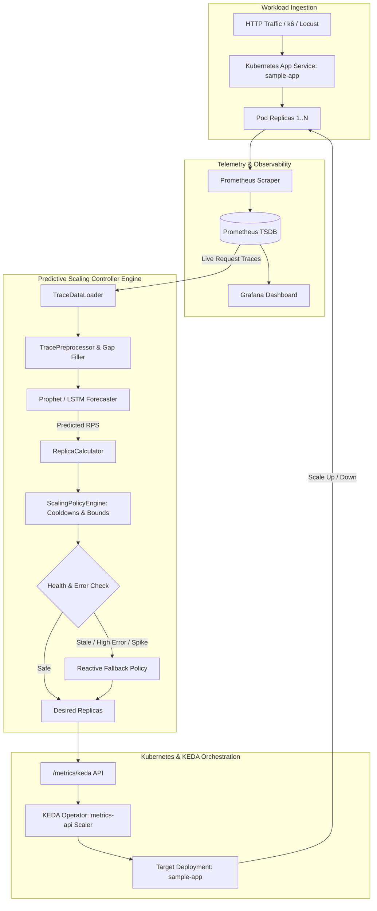

# System and Validation Architecture

## 1. System Overview

The **Predictive Autoscaling with Load Forecasting** system enables Kubernetes workloads to dynamically adapt to anticipated traffic demand rather than reacting after latency degradation or resource saturation has already occurred.

## 2. Core Components

### 2.1 Trace Ingestion & Preprocessing (`app/forecasting/`)
- **`TraceDataLoader`**: Ingests incoming batch points or CSV traces. Ensures zero time-leakage via chronological splitting. Tracks SHA-256 provenance hashes.
- **`TracePreprocessor`**: Resamples irregularly spaced metric emissions onto a unified time grid (e.g., 60-second intervals), applies IQR-based outlier detection, and transforms data to Prophet-compatible format (`ds`, `y`).

### 2.2 Forecasting Engine (`app/forecasting/prophet_model.py`, `lstm_model.py`)
- **Prophet Forecaster**: Non-linear regression fitting trend changes and daily/weekly seasonality with uncertainty intervals.
- **LSTM Forecaster**: Deep recurrent neural network baseline (PyTorch) using sequential sliding windows.

### 2.3 Predictive Scaling Controller (`app/controller/`)
- **`ReplicaCalculator`**: Translates predicted requests per second ($RPS_{pred}$) into desired pod replicas ($N_{desired}$):
  $$RPS_{buffered} = RPS_{pred} \times (1 + \text{safety\_margin\_percent})$$
  $$N_{raw} = \left\lceil \frac{RPS_{buffered}}{\text{safe\_capacity\_per\_replica}} \right\rceil$$
  $$N_{bounded} = \max(\text{min\_replicas}, \min(N_{raw}, \text{max\_replicas}))$$
- **`ScalingPolicyEngine`**: Enforces cooldowns (60s scale-up, 180s scale-down), bounded step-rate changes (max +3 / -2 pods per step), and comprehensive audit logging.
- **`FallbackHandler`**: Automatic fail-safe mode triggered upon stale telemetry (>120s), forecast error exceeding threshold (>35% MAPE), service unavailability, or sudden unexpected load surges.

### 2.4 KEDA Integration (`kubernetes/keda-scaledobject.yaml`)
- Exposes desired replicas over HTTP at `/metrics/keda`.
- KEDA queries the external metric and adjusts the Deployment without race conditions against the reactive HPA.
